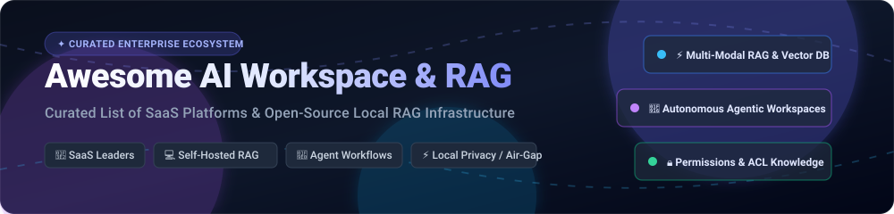

# 🧠 Awesome AI Workspace & RAG Ecosystem ⚡

**Curated Showcase of Top SaaS Platforms & Open-Source Infrastructure for Enterprise Search, Agentic Workspaces & Local RAG**

  <b>Enterprise Knowledge Retrieval</b> •
  <b>Agent-Augmented Chat</b> •
  <b>Local AI Workspaces</b> •
  <b>Air-Gapped RAG Pipelines</b> •
  <b>Hybrid Vector Search</b>

*Last updated: October 2026*

---

## 📖 Overview & SEO Summary

This repository is the authoritative index tracking notable **SaaS platforms** and production-grade **open-source frameworks** for **AI Workspace & Retrieval-Augmented Generation (RAG)**. 

Modern AI workspaces bridge Large Language Models (LLMs) with proprietary enterprise knowledge—documents, databases, SaaS applications, APIs, and communication archives. By employing **semantic vector embeddings**, **hybrid keyword search (BM25)**, **layout-aware document chunking**, **permissions-aware Access Control Lists (ACLs)**, and **multi-agent orchestration**, these solutions allow teams to build context-aware, air-gapped, or cloud-hosted AI environments with zero data leakage and verifiable citation-backed answers.

---

## 📑 Table of Contents

- [📊 Sector Overview & Market Dynamics](#-sector-overview--market-dynamics)
- [🏢 SaaS / Hosted Enterprise Platforms](#-saas--hosted-enterprise-platforms)
- [💻 Open-Source GitHub Projects](#-open-source-github-projects)
  - [Top Open-Source RAG Workspaces & Engines](#top-open-source-rag-workspaces--engines)
  - [Frameworks & Micro-Engines for Custom Pipelines](#frameworks--micro-engines-for-custom-pipelines)
- [🤝 How to Contribute](#-how-to-contribute)
- [💖 Support & Sponsorship](#-support--sponsorship)
- [📈 Star History](#-star-history)
- [⚠️ Disclaimer](#️-disclaimer)

---

## 📊 Sector Overview & Market Dynamics

The enterprise AI Workspace and Retrieval-Augmented Generation (RAG) market is estimated at approximately **$2.5B to $4B** in 2024–2026 and is projected to expand toward **$10B–$43B+ by the early 2030s** at an estimated 25–40% CAGR. 

The sector is **moderately to highly fragmented** rather than winner-take-all: while mega-cap platform providers (Microsoft Copilot, OpenAI, Anthropic) dominate horizontal desktop suites, specialized enterprise search engines (Glean, Moveworks), verticalized domain copilots, and rapidly advancing open-source RAG pipelines maintain substantial market differentiation and prevent complete platform consolidation.

---

## 🏢 SaaS / Hosted Enterprise Platforms

| Product | Company Valuation / Revenue | Pricing (Starting Tier) | Free Tier / Trial Limits | Description & Key Features |
| :--- | :--- | :--- | :--- | :--- |
| **[Microsoft Copilot](https://www.microsoft.com/en-us/microsoft-copilot)** | ~$3.1T Market Cap | $30 / user / month (Microsoft 365 Copilot add-on, billed annually) | **Free tier available**: Basic Copilot web chat is free for personal Microsoft accounts with daily prompt limits (up to ~30 turns/session); enterprise Graph-grounded Copilot offers no free tier (requires paid 365 business license). | AI assistant integrated across Microsoft 365. Features Graph-grounded responses from organizational data, Copilot Studio for custom agents, and enterprise data protection. |
| **[ChatGPT Enterprise](https://openai.com/enterprise/)** | ~$157B Valuation | $25 / user / month (ChatGPT Team, billed annually at $30/mo monthly; Enterprise custom quoted ~60/user/mo) | **Free tier available**: Free plan includes access to GPT-4o with standard dynamic rate limits (switches to mini when capacity reached); does not include team knowledge bases or enterprise admin controls. | Enterprise AI workspace with unlimited GPT-4 access, SSO/SAML, admin console, zero data retention, and custom knowledge bases/GPTs for team workflows. |
| **[Claude Enterprise](https://www.anthropic.com/enterprise)** | ~$40B Valuation | $25 / user / month (Claude Team, billed annually; Enterprise tier custom quoted ~30-50/user/mo) | **Free tier available**: Free Claude plan gives personal access to Claude 3.5 Sonnet with daily message caps (resets every 5 hours based on server load); does not include team Projects or enterprise admin controls. | Enterprise access to Claude with Projects for document-grounded conversations, SSO, admin controls, higher rate limits, and citation-backed answers. |
| **[Notion AI](https://www.notion.so/product/ai)** | ~$10B Valuation | $8 / user / month (billed annually, or $10/user/mo monthly as an add-on to Notion plans) | **Free trial available**: 20 free AI responses per member for workspace evaluation before requiring the $8–$10/user/month add-on subscription. | AI features embedded across Notion's all-in-one workspace. Q&A across entire workspace, AI writing assistance, autofill database properties, and AI meeting notes. |
| **[Perplexity Enterprise](https://www.perplexity.ai/enterprise)** | ~$9B Valuation | $40 / user / month (billed annually, or $40/user/mo monthly for Enterprise Pro) | **Free tier available**: Standard Perplexity Free plan provides unlimited basic quick searches and up to 5 Pro Searches (with file upload/reasoning) per day. | Enterprise answer engine combining internal knowledge search with web search, user management, SOC 2 compliance, and strict data retention controls. |
| **[Cohere Coral](https://cohere.com/coral)** | ~$5.5B Valuation | $10 / month (Developer API pay-as-you-go starting baseline; enterprise Coral managed deployment custom quoted) | **Free trial available**: Cohere provides a free trial evaluation key with 1,000 free API calls/month for testing models and RAG endpoints. | Enterprise knowledge assistant with RAG over internal documents, connectors to common SaaS apps, and citation-backed answers built on Cohere Command models. |
| **[Glean](https://www.glean.com/)** | ~$4.6B Valuation | ~$35 / user / month (mid-market/enterprise pricing, typically starting at $25,000–$60,000/year minimum contract value) | **No self-serve free tier or free trial**: Sales-led evaluation only via scheduled POCs for qualified enterprise deployments (typically 50–100+ seats minimum). | Enterprise search and AI platform with 100+ connectors, permissions-aware retrieval mirroring source-system ACLs, and Glean Assistant for corporate knowledge Q&A. |
| **[Moveworks](https://www.moveworks.com/)** | ~$2.1B Valuation | ~$150 / user / year on AWS Marketplace (~$15–$45/employee/year enterprise-wide; min contract ~$50,000–$100,000/yr) | **No free tier or public trial**: Sales-led enterprise engagements only with guided pilot/PoC on custom request. | AI-powered employee support platform with knowledge retrieval across IT, HR, and finance systems, autonomous issue resolution, and workflow automation. |
| **[Writer.com](https://writer.com/)** | ~$1.9B Valuation | $18 / user / month (Team plan for up to 5 users, billed monthly or annually) | **Free trial available**: 14-day free trial on the Team tier with access to Palmyra LLMs, document Q&A, and style guides. | Enterprise AI writing and knowledge platform with AI-powered document Q&A, style guides, and brand-consistent content generation. |
| **[Jasper Enterprise](https://www.jasper.ai/)** | ~$1.5B Valuation | $39 / seat / month (Creator plan, billed annually at $49/mo monthly; Pro tier is $59/seat/mo) | **Free trial available**: 7-day free trial on Pro and Creator plans providing full access to brand voice and workspace features. | Enterprise AI marketing platform with brand voice, knowledge base, campaign workflows, and Jasper Chat for grounded Q&A. |

---

## 💻 Open-Source GitHub Projects

Below is a ranked collection of production-ready open-source AI workspaces, RAG engines, and local knowledge base platforms. All entries are sorted strictly in descending order by GitHub stargazers.

### Top Open-Source RAG Workspaces & Engines

1. **[Dify](https://github.com/langgenius/dify)**   
   **Leading visual AI workflow and RAG orchestration platform** (Apache-2.0 with commons clause). Combines drag-and-drop workflow canvas, comprehensive RAG pipeline with multimodal PDF/DOCX chunking, autonomous agent sandbox, and deep LLMOps observability (Opik, Langfuse, Arize Phoenix). Supports any OpenAI-compatible LLM, local models via Ollama, and one-click deployment via Docker Compose.

2. **[Open WebUI](https://github.com/open-webui/open-webui)**   
   **Extensible, feature-rich, user-friendly self-hosted AI interface** (BSD-3-Clause). Features native multi-model support, localized document RAG with hybrid search, granular Role-Based Access Control (RBAC), custom pipelines, web search integration, and 100% offline air-gapped operation with Ollama.

3. **[RAGFlow](https://github.com/infiniflow/ragflow)**   
   **Open-source RAG engine built on deep document understanding** (Apache-2.0). Employs the DeepDoc layout-aware parser to extract complex tables, multi-column PDFs, and scanned images. Integrates Elasticsearch/Infinity BM25 and dense vector search with rerankers, providing traceable sentence-level citations and visual agent graph flows.

4. **[LobeChat](https://github.com/lobehub/lobe-chat)**   
   **Modern, visually polished open-source AI chat framework** (LobeHub Community License). Offers comprehensive multi-provider LLM support, native knowledge base management with vector embedding search, an extensible plugin marketplace, artifact rendering, and one-click deployment to Vercel or Docker.

5. **[AnythingLLM](https://github.com/Mintplex-Labs/anything-llm)**   
   **All-in-one local AI workspace with zero-setup RAG & autonomous agents** (MIT). Provides isolated containerized workspaces that prevent cross-document context contamination. Features multi-user RBAC (Docker), no-code agent builder, MCP protocol compatibility, embeddable web chat widgets, and support for LanceDB, Chroma, Pinecone, and Qdrant.

6. **[Flowise](https://github.com/FlowiseAI/Flowise)**   
   **Drag-and-drop UI for building customized LLM apps and RAG chains** (MIT). Built with LangChain and LlamaIndex primitives, allowing visual creation of conversational RAG agents, memory persistence, vector store querying, and webhooks with zero boilerplate code.

7. **[LibreChat](https://github.com/danny-avila/LibreChat)**   
   **Enhanced open-source ChatGPT clone with multi-provider RAG & agents** (MIT). Features conversation branching, multimodal uploads, code interpreter execution, multi-user authentication, and native integration with custom endpoints and local embedding models.

8. **[Langchain-Chatchat](https://github.com/chatchat-space/Langchain-Chatchat)**   
   **Local knowledge base Q&A application built with LangChain and Milvus/Chroma** (Apache-2.0). Designed for full offline enterprise deployments, supporting Chinese & English document extraction, local LLM fine-tuning weights, and Milvus/FAISS vector databases.

9. **[Khoj](https://github.com/khoj-ai/khoj)**   
   **Personal AI assistant and second brain that searches your notes and documents** (AGPL-3.0). Integrates with Obsidian, Emacs, web search, PDF, Markdown, and Notion documents, acting as an offline or self-hosted conversational search companion.

10. **[Onyx (formerly Danswer)](https://github.com/onyx-dot-app/onyx)**   
    **Mature open-source enterprise search and Glean alternative** (MIT core). Connects to 40+ workplace data sources (Slack, Google Drive, Confluence, Jira, GitHub, Notion) while rigorously inheriting native system Access Control Lists (ACLs). Employs hybrid search, automated knowledge graphs, and verifiable inline citations.

11. **[STORM](https://github.com/stanford-oval/storm)**   
    **Stanford's LLM system for automated long-form synthesis and multi-perspective research** (MIT). Uses multi-turn RAG dialogue simulations with automated citation retrieval to generate comprehensive Wikipedia-like research reports on any topic from scratch.

12. **[Haystack](https://github.com/deepset-ai/haystack)**   
    **Production-ready Python framework for building custom RAG pipelines and search systems** (Apache-2.0). Features strongly-typed pipeline components, state-of-the-art document splitters, hybrid reranking, and enterprise observability.

---

### Frameworks & Micro-Engines for Custom Pipelines

- **[SemantixRAG](https://pypi.org/project/semantixrag/)** — Open-source RAG platform with GraphRAG, Neo4j knowledge graphs, OpenSearch hybrid retrieval, Microsoft Presidio PII scanning, and GDPR DSAR compliance automation.
- **[Velites](https://pypi.org/project/velites/)** — Minimal, local-first AI workbench with SQLite-powered RAG in a single-process distroless container (Apache-2.0).
- **n8n Community Workflows** — Open workflow automation nodes for building custom multi-step ingestion, vectorization, and webhook notification RAG flows.

---

## 🤝 How to Contribute

Contributions are welcome! Help keep this ecosystem up-to-date:

1. 🍴 Fork the repository.
2. 📝 Add or edit entries in `README.md` following the standard table or list format.
3. 🔗 Ensure all links are official, factual, and include accurate licenses and pricing/trial tiers.
4. 🚀 Submit a Pull Request with a clear description of your addition.

---

## 💖 Support & Sponsorship

If this curated AI Workspace & RAG directory saved you research hours or helped your engineering team choose the right platform, please consider showing your support:

- ⭐ **Star this repository** to help others discover it!
- 🍴 **Fork and share** with colleagues and platform teams.
- ☕ **Buy a coffee & sponsor**: Support continuous maintenance on the [GitHub Sponsor Dashboard](https://github.com/sponsors/ishandutta2007).

---

## 📈 Star History

---

## ⚠️ Disclaimer

- This is a **community-curated index** — provided for informational purposes without formal commercial endorsement.
- Organizations deploying enterprise AI workspaces handling sensitive documents must ensure compliance with applicable regulations (GDPR, HIPAA, SOC 2) and respect granular source-system access controls (ACLs).
- **Self-hosted RAG is production-ready:** Solutions like Dify, Open WebUI, RAGFlow, Onyx, and AnythingLLM provide robust, privacy-first alternatives to closed-box hosted assistants.
- Always validate chunking fidelity, retriever precision, and embedding latency against representative real-world document corpora before rolling out to production.

---

  <b>Built with ❤️ for AI engineers, data platform architects, and developers shaping the future of context-aware intelligence.</b>

